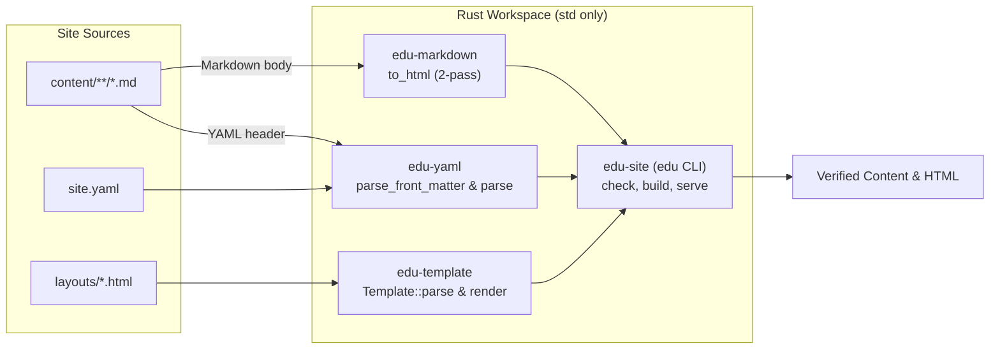
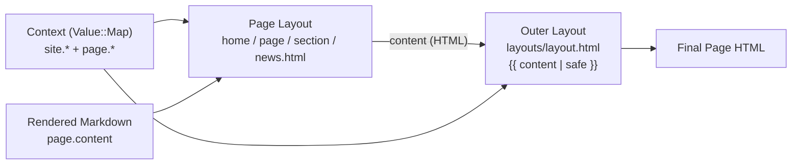

# Rust-edu
[](https://github.com/rust-edu/rust-edu.github.io/actions)
[](https://rust-edu.zulip.cs.pdx.edu/)


Rust Edu is an organization dedicated to supporting Rust education in the academic environment. This website is built using [Zola](https://www.getzola.org/), a blazing-fast static site generator in Rust.

## 🚀 Setting Up on Local Machine
To contribute or run this website locally, follow the steps below.

To change only the content, see [docs/editing.md](docs/editing.md): every page is a Markdown file under `content/`.

### ✅ Requirements
- Zola **0.22.1** installed, the version CI builds and deploys with

## 📦 Installation Steps
### 1. Clone the Repository
```bash
git clone https://github.com/rust-edu/rust-edu.github.io.git
cd rust-edu.github.io
```

### 2. Install Zola 0.22.1
Download the binary for your system from [Zola 0.22.1](https://github.com/getzola/zola/releases/tag/v0.22.1),
or, with [Rust](https://www.rust-lang.org/tools/install) installed, build it with Cargo:
```bash
cargo install --locked --git https://github.com/getzola/zola --tag v0.22.1 zola
```

## 💻 Run Locally
Start a local development server:
```bash
zola serve
```
Your site will be live at: http://127.0.0.1:1111

Zola will auto-reload when changes are made.

## 🎨 Layout and Style
- `templates/`: the HTML layout of each kind of page (Zola's Tera templates)
- `static/style.css`: the whole stylesheet, plain CSS with its colors in one token block at the top
- `config.toml`: the site title and description, and the menu and footer links
- `layouts/` and `site.yaml`: the same layouts and settings for the new generator below; until it replaces Zola,
  a change to `templates/` or `config.toml` goes in both

## 🦀 The New Generator (in progress)
[Plan 0002](docs/Plan-0002—Own-Markdown-Site-Generator.md) replaces Zola, step by step, with a small generator in
`crates/` that uses only the Rust standard library; Zola builds and deploys the site until the switch.

### How it works


- **Standard library only:** `Cargo.lock` lists only the four crates of this workspace (`edition = "2024"`,
  `rust-version = "1.99.1"`, `unsafe_code = "forbid"`). CI rejects any external crate in `Cargo.lock` and builds and
  tests with `--network=none --locked --offline` inside a digest-pinned Docker image.
- **Strict subsets, no panics:** Each parser accepts the subset of YAML 1.2, CommonMark or the template language that
  the site uses, and rejects anything outside it with `file:line:col` and a hint. Input paths never call `unwrap`,
  `expect` or `panic!`, and a seeded random-input test in each parser crate checks 5,000 damaged inputs per run.
- **Four crates under `crates/`:**
  - `crates/yaml` (`edu-yaml`) — block-style YAML maps, lists, lists of maps and `---` page headers; every scalar stays
    a string so `no` never becomes `false`.
  - `crates/markdown` (`edu-markdown`) — a two-pass CommonMark subset (paragraphs, `#` headings with Zola's ASCII ids,
    fenced code, `>` quotes, nested lists, code spans, links, images, autolinks, emphasis and escapes), tested byte for
    byte against Zola 0.22.1's HTML on every page of the site.
  - `crates/template` (`edu-template`) — layout templates rendered with a `Value` tree (`Str`, `Bool`, `List` and
    ordered `Map`): `{{ path }}` writes text with `&`, `<`, `>`, `"` and `'` escaped, `{{ path | safe }}` writes raw
    HTML such as `page.content`, `{# … #}` is a comment, and `if`/`else`/`for` handle branches and lists, with one
    outer `layouts/layout.html` wrapping each page layout (`home.html`, `page.html`, `section.html`, `news.html`) at
    `{{ content | safe }}` instead of `extends` and `block`.
  - `crates/site` (`edu-site`, binary `edu`) — the command-line tool. `edu check` checks `site.yaml`, the layouts in
    `layouts/`, and the YAML header and Markdown text of every page in `content/`, then renders every page with
    them; `edu build` checks the same, then writes the site into `public/`, with a page for each `redirect_to`,
    `404.html`, `robots.txt` and `sitemap.xml`; `edu serve` follows in step 7.



### Check locally
CI runs the generator checks, `edu check`, and two builds that must be the same, inside the pinned Docker image; the
same check runs locally with:
```bash
docker build --target check .
```
With [Rust](https://www.rust-lang.org/tools/install) installed, `rust-toolchain.toml` selects Rust 1.99.1:
```bash
cargo test
cargo run -p edu-site -- check
```

## 📬 Get Involved
Interested in contributing or learning more?
* 🌐 Visit: [https://rust-edu.org/](https://rust-edu.org/)
* 📧 Email: [contact@rust-edu.org](mailto:contact@rust-edu.org)
Let’s build the future of Rust education together!