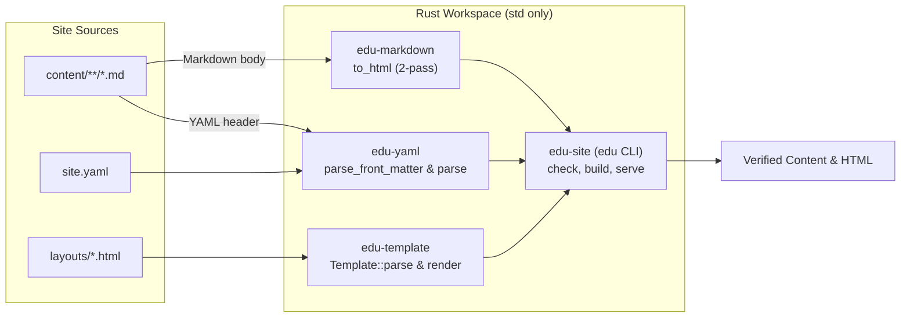
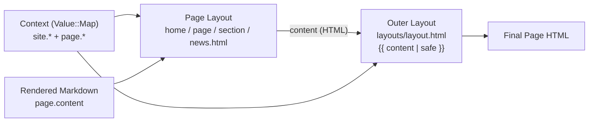

# Rust-edu
[](https://github.com/rust-edu/rust-edu.github.io/actions/workflows/deploy.yml)
[](https://rust-edu.zulip.cs.pdx.edu/)


Rust Edu is an organization dedicated to supporting Rust education in the academic environment. This website is built by its own small static site generator, written in Rust with only the standard library.

## 🚀 Setting Up on Local Machine
To contribute or run this website locally, follow the steps below.

To change only the content, see [docs/editing.md](docs/editing.md): every page is a Markdown file under `content/`.

### ✅ Requirements
- [Docker](https://docs.docker.com/get-started/get-docker/) with Compose, which runs the generator in the image that
  CI and the deploy use
- or [Rust](https://www.rust-lang.org/tools/install), with Rust 1.99.1 selected by `rust-toolchain.toml`

## 📦 Installation Steps
Clone the repository:
```bash
git clone https://github.com/rust-edu/rust-edu.github.io.git
cd rust-edu.github.io
```

## 💻 Run Locally
Start a local server:
```bash
docker compose up
```
Your site will be live at: http://127.0.0.1:1111, drafts too.

After a change, reloading the page builds the site again; while the site has errors, the page shows them instead.
With Rust installed, `cargo run -p edu-site -- serve --drafts` does the same.

## 🎨 Layout and Style
- `layouts/`: the HTML layout of each kind of page
- `static/style.css`: the whole stylesheet, plain CSS with its colors in one token block at the top
- `site.yaml`: the site's address, title and description, and the menu and footer links

## 🦀 The Generator
[Plan 0002](docs/Plan-0002—Own-Markdown-Site-Generator.md) replaced Zola with a small generator in `crates/` that
uses only the Rust standard library.

### How it works


- **Standard library only:** `Cargo.lock` lists only the four crates of this workspace (`edition = "2024"`,
  `rust-version = "1.99.1"`, `unsafe_code = "forbid"`). CI rejects any external crate in `Cargo.lock` and builds and
  tests with `--network=none --locked --offline` inside a digest-pinned Docker image.
- **Strict subsets, no panics:** Each parser accepts the subset of YAML 1.2, CommonMark or the template language that
  the site uses, and rejects anything outside it with `file:line:col` and a hint. Input paths never call `unwrap`,
  `expect` or `panic!`, and a seeded random-input test in each parser crate checks 5,000 damaged inputs per run.
- **Safe types of file:** Besides the pages, which have no HTML, `content/` and `static/` hold only images, PDF
  and text files, LaTeX files and stylesheets; an SVG image passes only without scripts, event attributes,
  `javascript:` addresses or HTML.
- **Only the site's own files:** The generator refuses symbolic links, which could bring files from outside the
  repository into the site, and leaves out files and folders whose names start with `.`, such as `.DS_Store`.
- **Four crates under `crates/`:**
  - `crates/yaml` (`edu-yaml`) — block-style YAML maps, lists, lists of maps and `---` page headers; every scalar stays
    a string so `no` never becomes `false`.
  - `crates/markdown` (`edu-markdown`) — a two-pass CommonMark subset (paragraphs, `#` headings with ids in any script,
    fenced code, `>` quotes, nested lists, code spans, links, images, autolinks, emphasis and escapes), tested byte for
    byte against Zola 0.22.1's HTML on every page of the site.
  - `crates/template` (`edu-template`) — layout templates rendered with a `Value` tree (`Str`, `Bool`, `List` and
    ordered `Map`): `{{ path }}` writes text with `&`, `<`, `>`, `"` and `'` escaped, `{{ path | safe }}` writes raw
    HTML such as `page.content`, `{# … #}` is a comment, and `if`/`else`/`for` handle branches and lists, with one
    outer `layouts/layout.html` wrapping each page layout (`home.html`, `page.html`, `section.html`, `news.html`) at
    `{{ content | safe }}` instead of `extends` and `block`.
  - `crates/site` (`edu-site`, binary `edu`) — the command-line tool. `edu check` checks `site.yaml`, the layouts in
    `layouts/`, and the YAML header and Markdown text of every page in `content/`, renders every page with them,
    and follows every link between the pages and files of the site and each address of `urls.txt`, the addresses
    that other sites may link to. `edu build` checks the same, then writes the site into `public/`, with a page for
    each `redirect_to`, `404.html`, `robots.txt` and `sitemap.xml`. It leaves out the drafts, unless `--drafts`, and
    builds for the `base_url` of `site.yaml`, unless `--base-url` gives another, such as a fork's Pages site.
    `edu serve` builds the site in memory and serves it at http://127.0.0.1:1111 as GitHub Pages would, building it
    again on a request after a change, and showing the errors, if any, instead of the page.



### Check locally
CI runs the generator checks, `edu check`, and two builds that must be the same, inside the pinned Docker image; the
same check runs locally with:
```bash
docker build --target check .
```
With [Rust](https://www.rust-lang.org/tools/install) installed, `rust-toolchain.toml` selects Rust 1.99.1:
```bash
cargo test
cargo run -p edu-site -- check
```
`edu build` writes the site into `public/`, for the `base_url` of `site.yaml` or for the address of `--base-url`:
```bash
cargo run -p edu-site -- build
```

### Preview of a pull request
The checks of each pull request attach the site with its drafts as `site-preview`; its links start at the top of a
site, so serve the unpacked folder at the root of an address, as with `python3 -m http.server -d site-preview 1111`,
rather than opening its files.

### Deploy
`.github/workflows/deploy.yml` runs on each push to `main`: it checks and builds the site in Docker and publishes it
with GitHub's own Pages actions, at the address that Pages gives the site, which the build takes as `--base-url`. It
needs *Settings → Pages → Source* set to *GitHub Actions*; a fork with that setting gets the site at its own Pages
address. *Actions → Deploy to GitHub Pages → Run workflow* runs it again by hand. Locally,
`docker build --target site -o site .` writes the same site, for rust-edu.org, into `site/`.

Dependabot proposes updates of the actions, which are pinned by commit, and of the Docker image together with
`rust-toolchain.toml`, so that a Rust release bumps both in one pull request.

## 📬 Get Involved
Interested in contributing or learning more?
* 🌐 Visit: [https://rust-edu.org/](https://rust-edu.org/)
* 📧 Email: [contact@rust-edu.org](mailto:contact@rust-edu.org)
Let’s build the future of Rust education together!