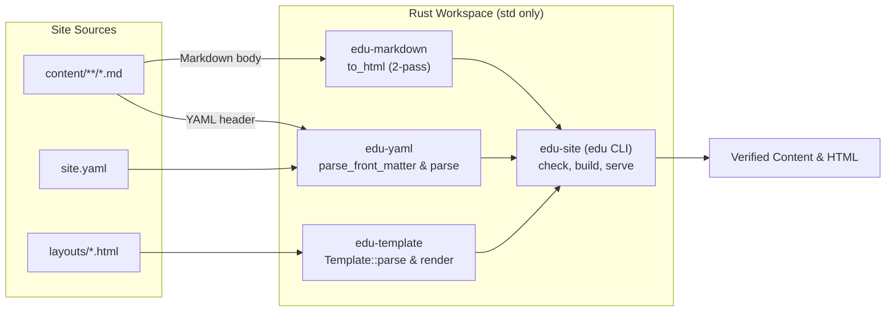
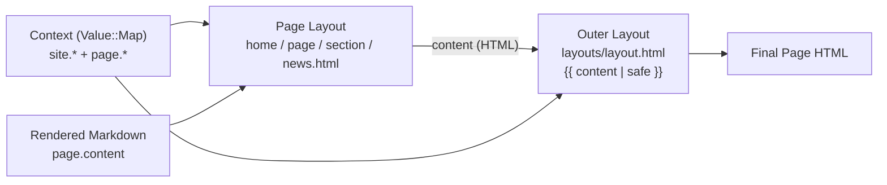

# The generator

For people who maintain or change the generator. Paths to crates in this guide start at the repository root.
To change a website page, see the [editing guide](../../docs/editing.md). For local checks and deployment,
see the [website README](../../README.md).

The site is built by its own small generator, which uses only the Rust standard library. It replaced Zola;
[Plan 0002](design/Plan-0002—Own-Markdown-Site-Generator.md) records why and how.

## How it works

## The four crates

- `crates/yaml` (`edu-yaml`): block-style YAML maps, lists, lists of maps and `---` page headers; every scalar stays
  a string so `no` never becomes `false`.
- `crates/markdown` (`edu-markdown`): a two-pass CommonMark subset (paragraphs, `#` headings with ids in any script,
  fenced code, `>` quotes, nested lists, code spans, links, images, autolinks, emphasis and escapes), tested byte for
  byte against Zola 0.22.1's HTML on every page of the site.
- `crates/template` (`edu-template`): layout templates rendered with a `Value` tree (`Str`, `Bool`, `List` and
  ordered `Map`). `{{ path }}` writes text with `&`, `<`, `>`, `"` and `'` escaped, `{{ path | safe }}` writes raw
  HTML such as `page.content`, `{# … #}` is a comment, and `if`/`else`/`for` handle branches and lists. One outer
  `layouts/layout.html` wraps each page layout (`home.html`, `page.html`, `section.html`, `news.html`, `404.html`)
  at `{{ content | safe }}`, instead of `extends` and `block`.
- `crates/site` (`edu-site`, binary `edu`): the command-line tool, with three commands.
  - `edu check` checks `site.yaml`, the layouts in `layouts/`, and the YAML header and Markdown text of every page
    in `content/`, renders every page with them, and follows every link between the pages and files of the site and
    each address of `urls.yaml`: the addresses that other sites may link to (`keep`) and the redirects
    (`redirects`).
  - `edu build` checks the same, then writes the site into `public/`, with a page for each redirect, `404.html`,
    `llms.txt`, `robots.txt`, `sitemap.xml`, and `atom.xml` and `rss.xml`, the Atom 1.0 and RSS 2.0 feeds of the
    pages of a section with `sort_by: date`. It leaves out the drafts, unless `--drafts`, and builds for the
    `base_url` of `site.yaml`, unless `--base-url` gives another, such as a fork's Pages site; the ids of the feeds'
    posts keep the `base_url` of `site.yaml`.
  - `edu serve` builds the site in memory and serves it at http://127.0.0.1:1111 as GitHub Pages would, building it
    again on a request after a change, and showing the errors, if any, instead of the page.

## What it accepts

- **Safe types of file:** Besides the pages, which have no HTML, `content/` and `static/` hold only images, PDF
  and text files, LaTeX files and stylesheets; an SVG image passes only without scripts, event attributes,
  `javascript:` addresses or HTML.
- **Only the site's own files:** The generator refuses symbolic links, which could bring files from outside the
  repository into the site, and leaves out files and folders whose names start with `.`, such as `.DS_Store`.

[The website editing guide](../../docs/editing.md) lists the types of file, the keys of a page's header and the Markdown, as an editor sees
them.

## Rules for a change

These hold for every change to `crates/`, whoever writes it.

- **Standard library only.** Do not add a crate. `Cargo.lock` lists only the four crates of this workspace
  (`edition = "2024"`, `rust-version = "1.99"`). `make guards` fails, on a laptop and in CI, when it lists a crate
  from a registry or git, or any crate but these four, and the Docker build compiles and tests with
  `--network=none --locked --offline` inside an image pinned by digest.
- **No `unsafe`.** The workspace forbids it (`unsafe_code = "forbid"`).
- **No panics on input.** Return an error instead of calling `unwrap`, `expect` or `panic!`; only tests may call
  them. A seeded random-input test in each parser crate checks 5,000 damaged inputs per run.
- **Strict parsers.** Each parser accepts only the subset of YAML 1.2, CommonMark or the template language that the
  site uses, and rejects anything else with `file:line:col` and a hint. It does not skip or guess at input that it
  does not know.
- **Enums over strings.** Model a closed set of cases as an enum and match every variant. Do not match on marker
  strings or read the same bytes a second time, and give error kinds their own variants, not `&'static str` tags. A
  `_` arm is fine only where the input is open text being parsed.
- **Stable Markdown output.** `crates/markdown/tests/golden/` holds the expected HTML of the site's pages. Change
  it only when the output is meant to change.
- **Tests with each change.** Each crate has a `tests/` folder, and `crates/site/tests/sites/` holds small example
  sites.

`make check` must pass before a change is done; the [README](../../README.md#check-locally) lists it with the other
commands. When a check or a test fails, fix the cause; do not weaken the check to make it pass.
