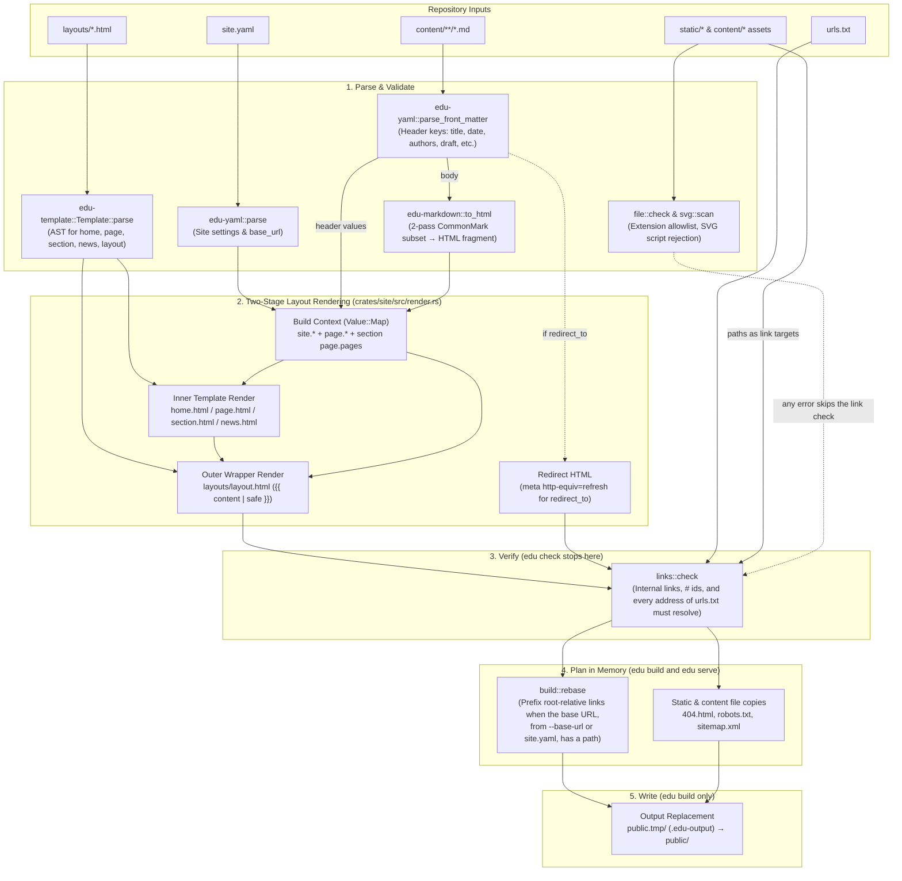
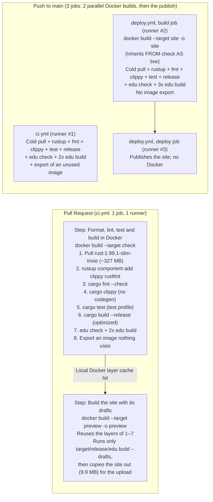

# Research 0005 — Renderer Architecture & CI/CD Compilation Review
**Date:** 2026-11-08, corrected 2026-11-09 · **Status:** for review

This note reviews the site's Rust generator (`crates/`), explains how compilation and caching behave across local
builds and GitHub Actions (`.github/workflows/ci.yml`, `.github/workflows/deploy.yml`, `Dockerfile`), and gives a plan
to improve the CI/CD builds.

**The short version.** A CI job that starts with nothing cached (a "cold" job, as every job is today) takes about 35 s,
and compiling and testing are only about 7 s of it. The largest step that can be removed is an image export that nothing
uses, 5–8 s per CI job, and one flag removes it. Dropping CI's duplicate run on `main` is good cleanup, but it shortens
nobody's wait and saves no money. Cross-run caching should stay off: even a full hit skips only about 13 s [8.8–16.1],
before the cost of restoring it. The `live` stage of the `Dockerfile` must stay `FROM check`, or `main` could publish
with failing tests. §3 has the plan.

**How to read the numbers.**

- *Runner*: measured from the GitHub Actions logs of the fork (`kenesparta/rust-edu.github.io`, where this work happens;
  "upstream" means `rust-edu/rust-edu.github.io`) on `ubuntu-26.04`: BuildKit's own `#N DONE` times for build steps and
  the GitHub API for job and run totals, as median [min–max]. They cover `ci` runs from 2026-11-05 to 11-09 and `Deploy`
  runs from 11-07 to 11-09.
- *Local*: measured on an arm64 Mac, in a throwaway Docker-in-Docker container for Docker builds and directly on the Mac
  for the `edu` timings of §1.3. Use these to compare two variants, not as absolute times.
- *Estimate*: worked out from the above, and not run.

**None of the changes in §3 has run on GitHub yet.**

---

## 1. Review of the Renderer Architecture

The generator is a zero-dependency Rust workspace (`edition = "2024"`, `rust-version = "1.99.1"`, with
`unsafe_code = "forbid"` as a workspace lint). It has 7,553 lines of Rust, counting comments and blanks: 4,772 of
implementation and 2,781 of tests (1,455 in `tests/*.rs` and 1,326 in `#[cfg(test)]` modules of `crates/site/src`),
across four crates.

### 1.1 End-to-End Rendering Pipeline



Symlinks are refused before this point, by `check::walk` and `check::read`.

### 1.2 Crate-by-Crate Review

| Crate | Source lines | Test lines | Role in Rendering & Strengths |
|---|---:|---:|---|
| `edu-yaml` (`crates/yaml`) | 394 | 325 | Splits `---` front matter and parses block-style maps and lists. Keeps all scalars as `String` (so `no` never turns into `false`) and rejects anchors, flow collections, and unquoted `: ` with exact `line:col` hints. |
| `edu-markdown` (`crates/markdown`) | 1,368 | 727 | Two-pass CommonMark subset parser and HTML renderer (`to_html`). Pass 1 (`Parser::blocks`) parses paragraphs, ATX `#`–`######` headings, backtick/tilde code fences, `>` quotes, and tight/loose lists up to `MAX_DEPTH = 8`. Pass 2 (`inline::parse`) parses code spans, autolinks, balanced-paren links/images, and symmetric emphasis (`*`, `_`, `**`, `__`). Heading ids (`slug()`) keep letters and digits of any script in lowercase, joined by `-`, as GitHub does; for ASCII these are Zola's ids, and all 30 heading ids of the site's Markdown are ASCII today. `Html::heading` adds `-1`, `-2` for repeats on a page. Adds `rel="external"` to `http`/`https` links. |
| `edu-template` (`crates/template`) | 523 | 259 | Compiles `layouts/*.html` into a `Vec<Node>` AST (`Text`, `Print`, `If`, `For`) up to `MAX_DEPTH = 8`. Escapes `& < > " '` by default in `{{ path }}` and emits raw HTML only on `{{ path \| safe }}`. Because templates are loaded at runtime, editing `layouts/*.html` or `static/style.css` does not require recompiling Rust. |
| `edu-site` (`crates/site`) | 2,487 | 1,470 | Orchestrates `edu check`, `edu build`, and `edu serve`. `render.rs` does the Jekyll-style two-stage layout composition (inner layout rendered into `content`, then wrapped by `layouts/layout.html`) and section sorting (`Order::Url` or `Order::Date` newest-first). `check.rs` runs the pipeline. `links.rs` checks links and anchors. `svg.rs` fails the build on an image with a script, event attribute, `javascript:` address or HTML, and never rewrites an image. `build.rs` rebases links for a base URL with a path and writes the output: first `public.tmp/`, then it deletes `public/` and renames `public.tmp/`. A failed write leaves the old `public/` in place, but the swap itself is not atomic. Only folders with the `.edu-output` marker are ever deleted. |

### 1.3 Code Quality & Performance Observations

1. **No Third-Party Crates:** `Cargo.lock` lists only this workspace's four crates, and CI fails on any crate from a
   registry or git. A build still trusts the digest-pinned Rust image, the `rustup` download of clippy and rustfmt (the
   one `RUN` with network), the actions pinned by SHA (five, plus the `upload-artifact` that `upload-pages-artifact`
   pulls in), and the `ubuntu-latest` runner.
2. **Parser Tests:** the YAML, Markdown block, Markdown inline, template and SVG parsers each have a seeded random-input
   test: 5,000 copies of a sample with two random edits, using xorshift64 with a fixed seed, asserting no panic. They
   are not coverage-guided fuzzers. `edu-markdown` also has golden tests: `to_html` must match, byte for byte, a stored
   snapshot of Zola 0.22.1's HTML for the 9 pages with text, with 4 `#` links normalized. Zola itself no longer runs,
   and no fixture has a code block.
3. **Fast Site Rendering:** for all 11 pages, `edu check` takes about 6 ms and `edu build` about 13 ms (local, release
   binary). The layout render loop alone is sub-millisecond, about 130 µs.
4. **Repeated Passes (Minor, Intended):**
   - `crates/site/src/render.rs:146-153` clones `site` and `context` per page. `Template::render` already takes
     `&Value`; the clones exist because `Value::Map` owns its entries. `context.clone()` could be removed by building one
     map and pushing `content` into it. Neither clone is worth removing for speed: on a synthetic 5,000-page copy they
     are under 3% of the run, and reading and parsing the pages is about 70% (local).
   - `Dockerfile:27-29` runs `edu check`, then `edu build` twice (`diff -r /tmp/first public`), and `live` (`:36`) or
     `drafts` (`:44`) runs `edu build` once more. `edu build` also runs `check::pages`
     (`crates/site/src/build.rs:127`), so pages are parsed and rendered 3 times for `--target check` and 4 times for
     `--target site` or `--target preview`. Each run has a purpose: `edu check` includes drafts while `edu build` leaves
     them out, the second build shows that the same binary writes the same files, and the last build makes what is
     published or previewed. Keep them all. One `edu build` takes about 7 ms [6–11] on the runner (n=30, the gap between
     the two `wrote` lines of the double build, so it includes `mv` and process start), and the three `RUN` steps cost
     about 0.2–0.3 s of a Docker build of about 20 s.

---

## 2. Does It Compile on Each CI/CD Run, or Is It Cached?

### Short Answer

**It compiles from scratch on every CI/CD run. Nothing is saved to a persistent cross-run cache in GitHub Actions.**

Neither Cargo's `target/` directory (`actions/cache`) nor Docker BuildKit layers (`type=gha`) are cached between
workflow runs, and both repositories hold 0 Actions caches. The only reuse today is inside one pull request job, where
the preview build reuses the check build's layers, and on a laptop, in a local `docker build` such as `make ci`. On every
push to `main`, the whole Rust workspace is compiled twice in parallel, by `ci.yml` and `deploy.yml`.

Compiling is not the main cost, though.

### Where the Time Goes

Runner, in seconds:

| Part | `ci` on a PR (n=13) | `ci` on a push (n=12) | `Deploy` on a push (n=5) |
|---|---|---|---|
| Pull and extract the base image | 5.4 [5.0–6.2] | 5.6 [4.9–7.0] | 5.4 [5.3–5.6] |
| `rustup component add` | 6.0 [3.1–7.9] | 6.4 [3.3–7.5] | 3.3 [3.3–6.6] |
| `cargo fmt` | 0.1 | 0.2 | 0.2 |
| `cargo clippy` | 0.8 [0.6–1.2] | 0.8 [0.6–1.5] | 1.0 [1.0–1.1] |
| `cargo test`, compile and run | 4.1 [2.8–5.3] | 4.1 [3.5–5.0] | 5.1 [4.4–5.2] |
| `cargo build --release` | 1.9 [1.6–3.1] | 2.1 [1.6–2.9] | 2.8 [2.5–3.0] |
| `edu check` and the `edu build` runs | about 0.2 | about 0.2 | about 0.3 |
| **Export** | **5.5 [5.3–8.4], an image nothing uses** | **6.9 [4.8–8.3], an image nothing uses** | 0.0, files to a folder |
| Check step, or Deploy's build step | 27 [24–29] | 29 [23–34] | 20 [19–25] |
| Whole job | 36 [34–38], n=7 with today's preview and upload | 33 [29–39] | build 29 [26–35], publish 12 [8–12] |
| Whole run, created to updated | 40 [38–43], n=7 with today's preview and upload | 37 [32–52] | 48 [45–69] |

- **Compile and test are small.** `clippy` + `test` + `release` take 7.1 s [5.0–9.6] over all 30 runs, and running the
  tests is about 1 s of that [0.7–1.7]. The pull, `rustup` and the export each take nearly as long as those three
  together: medians of 5–7 s on `ci`.
- **The export is the largest step that does no useful work.** It exists only in `ci.yml`, and the gap between `ci`'s
  docker step and `Deploy`'s is mostly this export. In the three latest `ci` runs it took 7.1, 8.4 and 8.0 s.
- **Single runs mislead.** Without queue waits, the same workflow still varies by 8–10 s (`ci` on push 32–42 s, n=11, or
  34–42 s, n=3, since 11-07; `Deploy` 45–54 s, n=4). To judge a change, read that step's `#N DONE`, or compare medians of
  at least 5 runs on nearby commits. Log timestamps inside `ci.yml`'s check step mean nothing, because `sed` holds the
  output back (§3.2).

### Detailed Breakdown of What Happens Today



1. **Across Different CI/CD Runs (No Cache):**
   - Every GitHub Actions job starts on a fresh `ubuntu-latest` VM with an empty Docker daemon.
   - Each job that builds pulls `rust:1.99.1-slim-trixie` (~327 MB compressed; median 5.4 s, about 2.4 s of it download
     and the rest extraction), downloads `clippy` and `rustfmt` with `rustup component add clippy rustfmt`
     (`Dockerfile:10`, 3–8 s), and compiles the workspace from scratch.
   - `research/0003-docker-build-and-pages-deploy.md` chose to skip BuildKit's `gha` cache (§2) and lists that as an
     honest cost (§6), for two reasons: with zero crates only layer order matters, and `gha` needs the containerd store
     or another driver, plus tokens. Its timings were estimates made before the generator existed (cold CI ≈ 1 min, pull
     ≈ 10–30 s), and it gives no compile time.

2. **Within a Single `docker build --target check .` (`Dockerfile:17-20`):**
   Cargo makes three passes over all four crates, and nothing is reused between them. Compile alone totals about 4–7 s.
   - `cargo clippy --workspace --all-targets --locked --offline -- -D warnings`: metadata and lints, no code generation
     (about 0.5–1 s).
   - `cargo test --workspace --locked --offline`: an unoptimized build in the test profile (about 1.7–3.4 s), then 128
     tests: unit, golden and CLI tests, and five seeded random-input tests of 5,000 inputs each, 25,000 in all.
   - `cargo build --workspace --release --locked --offline`: compiles `target/release/edu` with optimizations (about
     1.5–3 s).

3. **Within a Single Pull Request Job (`ci.yml:40-54`, Local VM Layer Reuse Works):**
   - The step "Format, lint, test and build in Docker, then check the pages" runs
     `docker build --progress=plain --target check .`, piped through `sed` to turn `edu check` errors into annotations
     (`ci.yml:44-50`).
   - The step "Build the site with its drafts" runs `docker build --progress=plain --target preview -o preview .`.
   - `FROM check AS drafts` (`Dockerfile:43`) builds on the same runner right after, so every `toolchain` and `check`
     layer is a cache hit. The step takes 1–2 s: `edu build --drafts`, a copy of `public/` into the scratch stage, and
     an export of 9.9 MB. The next step uploads that as the artifact.

4. **On Every Push to `main` (`ci.yml` + `deploy.yml`, Duplicate Cold Builds):**
   - Both `.github/workflows/ci.yml:3-5` and `.github/workflows/deploy.yml:7-9` trigger on `push: branches: [main]`.
   - `deploy.yml` runs `docker build --target site ...`, and `Dockerfile:34` defines `FROM check AS live`, so `deploy.yml`
     already runs the whole `check` stage (`cargo fmt`, `cargo clippy`, `cargo test`, `cargo build --release`,
     `edu check`, and the double `edu build`) before it builds the live site.
   - So every merge starts two parallel Docker builds on separate runners, and a third runner publishes. The two builds
     repeat the same pull, rustup and cargo passes, but they are not identical: `ci` also runs two shell guards and
     exports the unused image, and `Deploy` adds the live build.
   - `Deploy` does not wait for `ci`, so its own `check` stage is what stops a bad commit from being published. For
     example, 450a35b was published while its `ci` run was cancelled. On the fork, 27 of 28 `ci` runs on push tested the
     same tree that the pull request's run had already tested.

5. **On Local Machines:**
   - `make check` and `make serve` use the host's `cargo` with no Docker (`Makefile:5-9`, `:15`), and Cargo reuses
     `target/` between runs.
   - `make ci` runs `docker build --target check .`. The `Dockerfile` copies `Cargo.toml`, `Cargo.lock`, `clippy.toml`,
     `rust-toolchain.toml`, and `crates/` (`Dockerfile:15-16`) before `site.yaml`, `urls.txt`, `layouts/`, `static/` and
     `content/` (`Dockerfile:23-26`). Your Docker daemon keeps layers on disk, so a `content/` edit reuses the compiled
     binary and finishes in about a second (local, median 0.96 s, 1.83 s on the first edit).
   - `docker compose up` can reuse only the `toolchain` stage and the two `COPY` layers of `Dockerfile:15-16`, not the
     compiled binary or the site's files (seen locally with `docker build --target serve`; compose itself was not run).
     It builds the separate `serve` stage once, with its own release compile (`Dockerfile:50-54`), and mounts the
     repository read-only at `/site` (`compose.yaml:13`). `edu serve` then rebuilds the site in memory on the next request
     after a file changes. A `crates/` edit needs `docker compose up --build`.

---

## 3. The Plan

### 3.1 What to Optimize For

- **Minutes are free here.** Both repositories are public, and standard hosted runners are free for public repositories
  [billing]. The API reports 0 billable milliseconds on the runs checked. So less compute is not a reason to add anything.
- **Runner time and a person's wait are different.** On a pull request the author waits for the whole run. On a push, `ci`
  and `Deploy` start together, so the wait is `Deploy` alone: a median of 49 s from merge to published [46–71].
- **The time at stake is small.** On the fork, a merge came a median of 19 minutes after CI finished (n=28). So one-line
  fixes are worth making, and added complexity is not.
- **Rules that apply.** Standard library only (`AGENTS.md:47`, checked by `ci.yml:24-30`). Actions pinned by commit and
  the image by digest (`AGENTS.md:67`, checked by no job). GitHub's own actions (a decision in `docs/Plan-0002`, lines
  22–23). No rule asks for reproducible Docker builds: `Dockerfile:28-29` only checks that two site builds write the same
  files in a row.

| # | Action | Status | Effect | Cost and risk |
|---|---|---|---|---|
| 1 | Stop exporting the unused image (`ci.yml:45`) | **Do first** | About 5–8 s per `ci` run on `ubuntu-26.04` (cost measured on the runner; fix tested locally). Of steps 1 to 4, the only one that shortens anyone's wait | One flag |
| 2 | Stream the log with `sed -u` (`ci.yml:45`) | **Do with 1** | 0 s. Log lines arrive as they are written | One letter |
| 3 | Remove `push` from `ci.yml` | **Do next** | Removes a job of 30–39 s per push, 43–51% of a push's job time (n=5, the pushes that ran both workflows). Nobody waits less, and it saves no money | 2 lines deleted, and 2 `if:` lines that then do nothing. Some losses: §3.3 |
| 4 | Record in `AGENTS.md` that `live` must stay `FROM check` | **Do with 3** | That line becomes the only check of `main` | One line |
| 5 | Turn off incremental data and debug info in Docker | Optional | Estimate 1–2 s per build, in `ci` and `Deploy`. Below run-to-run noise | Two `ENV` values in the `toolchain` stage: `CARGO_INCREMENTAL=0` and `CARGO_PROFILE_DEV_DEBUG=0`. Backtraces lose line numbers; panic locations stay |
| 6 | Cross-run BuildKit cache | **Hold off** | About 13 s can be skipped [8.8–16.1], before restore cost. Net about 6 s locally on a content-only edit | Cache state, a payload of about 430 MB on the amd64 runner (estimate), a security risk: §3.5 |
| 7 | Shared `builder` stage for `check` and `serve` | Skip | 0 s in CI, because no CI job builds `serve`. About 1.6 s locally on `serve` after `check` | Format errors arrive later: 3.15 s against 1.68 s (local) |
| 8 | Publish with `target/debug/edu`, without the release build | Skip | 1.6–3.1 s per run, within noise | Publishes a debug build, and no CI job compiles the release profile any more |
| 9 | Path filters | Skip | Only 2 of 32 fork merges changed nothing the build reads | A third path list; a skipped check stays Pending if one is ever required [required] |
| 10 | Take `live` off `check` | **Reject** | 5.6–6.5 s per deploy | `main` publishes with failing tests: §3.6 |
| 11 | Make `deploy.yml` a job inside `ci.yml` | **Reject** | Removes the same duplicate run as #3, or publishes later than today | Inherits `cancel-in-progress`: §3.6 |
| 12 | `actions/cache` of `target/` or of a saved image | **Reject** | `target/` never reaches the build; a loaded image skips nothing unless a stage is built `FROM` it | That stage trusts the key alone: §3.6 |

What #1 to #4 do to the numbers:

| | Today | After |
|---|---|---|
| Pull request run | about 40 s | about 35 s (estimate) |
| Push to `main` | 3 jobs, 70–83 job-seconds (n=5) | 2 jobs, 38–47 job-seconds (estimate) |
| Merge to published | about 49 s | the same |
| Cost | $0 | $0 |

### 3.2 Steps 1 and 2: Stop the Export, Stream the Log

One line changes, in the step that runs the checks:

```diff
-          docker build --progress=plain --target check . 2>&1 | sed -E '
+          docker build --progress=plain --target check --output type=cacheonly . 2>&1 | sed -uE '
```

**Why the export exists.** With no tag and no `-o`, the docker driver exports an image by default. On Docker 29's
containerd store that means compressing every new layer, writing manifests and an attestation, and unpacking the result
as `moby-dangling@sha256:...`. No step uses it: the preview build reuses BuildKit's cache records, not the image. The
`cacheonly` exporter [cacheonly] runs the build and keeps the cache, with no image. `deploy.yml` gains nothing, since
its `-o site` already takes 0.0 s, and it does not change.

**The cost grows with `target/`, and upstream's runs do not show it yet.** On the fork, always on `ubuntu-26.04`, the
export went from 1.3 s on 11-02 to 5.4–8.4 s since 11-07 as the workspace grew. Upstream's run on `ubuntu-24.04` (Docker
28) exported the same commit in 1.2 s, against 7.1 s on 26.04 (n=1). `ubuntu-latest` finishes moving to 26.04 by 2026-11-19
[rollout], so upstream should soon see the fork's export times, and research/0003's "the image hides the OS change" (line
94) is not fully true. Leave the `runs-on` label alone: `cacheonly` removes the export on either image (local), and pinning
24.04 would add one more pin to maintain.

**Tested locally:**

| Test | Today | With the change |
|---|---|---|
| `--target check` on an empty engine | 21.29 s | 13.48 s |
| `--target preview` right after | 1.04 s, 14 steps cached | 0.26 s, 14 steps cached |
| Preview and site output | | byte-identical |
| A broken link, through the literal `ci.yml` filter | `::error file=...`, exit 1 | the same line, exit 1 |
| A format error or a failing test | exit 1, no annotation | the same |

A later run of the exact lines above took about 15 s against about 24 s, with no image left behind. The flag also ran
locally on Docker 28 with the classic store, which `ubuntu-24.04` is expected to use, so a run on either image should work
while the move finishes. It has not run on either runner image yet (§4).

**Why `sed -u`.** Since `20c63e5`, GNU `sed` block-buffers `docker build`'s output, so the log arrives in 4 KB bursts, the
first one 16–20 s into the step. A failing build still delivers its annotation, because the end of input flushes `sed`
(tested). `-u` makes the log show real progress, which helps most when a build hangs. It changes no build time.

**An alternative to `cacheonly`.** One `docker build --target preview -o preview .` through the same filter also skips the
export and drops a step. Its `-o` export has run on both runner images, but only on top of a `check` stage that the step
before had just built, and never through the filter. Locally, through the filter, it gave the `::error` line and a failed
build on a broken link. It is left out here because the PR's checks would then depend only on `FROM check AS drafts`, with
no workflow naming `--target check`.

**Later, separately:** the same flag in `make ci` (`Makefile:12`) would take a warm rebuild from 0.96 s to 0.30 s and stop
leaving a dangling image behind (local). CI does not need it, and `Dockerfile:3` and `README.md:114` show the bare
command too.

### 3.3 Steps 3 and 4: Remove the Duplicate Run on `main`

```diff
 on:
-  push:
-    branches: [main]
   pull_request:
```

The `if: github.event_name == 'pull_request'` lines (`ci.yml:53`, `:56`) then do nothing and can be removed. This also ends
a small oddity: `cancel-in-progress` (`ci.yml:11-13`) applies on `main` too, so 450a35b shows `cancelled` in `ci` although
it passed every check and was published (1 of 28 pushes).

**What goes away.** The risk is low, not zero:

- The `ci` status on `main` commits. Nothing depends on it: the README's badge is `Deploy`'s (`README.md:2`), and neither
  repository protects `main` or has rulesets.
- The `file:line` annotations on direct pushes. The same error still appears in `Deploy`'s log. Upstream's maintainers do
  push directly: 7 of the last 12 upstream pushes bypassed PRs (5 pushes and 2 force pushes, in 3 sessions: 2023-09,
  2024-02, 2026-05), all under the old Zola workflow.
- A check of `main` that does not publish: `ci.yml` has no `workflow_dispatch`, and running `deploy.yml` by hand publishes.
  To keep one, add `workflow_dispatch:` to `ci.yml` and keep its `if:` lines. On a fork without Pages turned on, `Deploy`
  should stop at "Ask Pages for the address" (`deploy.yml:31-33`), before Docker (read from the action's source, not run),
  so nothing would check `main` there.

**The guards do not need copying into `deploy.yml`.** They stay on pull requests, where their fast, clear messages help. On
`main` the build already stops each problem that changes what is built (local tests):

| Problem | Where the build stops it |
|---|---|
| No `Cargo.lock` | `COPY` fails |
| A registry or git crate | `cargo clippy` fails: with `--locked --offline` and no network, it cannot get the crate |
| A channel other than the image's Rust | `cargo fmt` fails: `rustup` cannot download with no network |
| Only the `FROM` tag is stale | The build does not stop it. Docker uses the digest and ignores the tag, so the build uses the pinned Rust. The guard catches it on the next PR |

So the comments that say CI fails on these (`AGENTS.md:47`, `:63`; `Dockerfile:5`; `rust-toolchain.toml:1`;
`.github/dependabot.yml:3`) hold for pull requests, and for direct pushes in every case except that last row. Copying would
be 16 lines for clearer messages and the tag check on direct pushes, so it is optional, and this plan leaves it out.

**Write this rule down.** After this step `FROM check AS live` (`Dockerfile:34`) is the only check of `main`. Moving `live`
off `check` takes only a small edit, about 8 to 15 lines (estimate): `FROM toolchain AS live` alone fails, because that
stage has no `edu` binary, so it also needs the `COPY` lines and a `cargo build`. No check would notice: `ci` stays green
and `main` publishes without its tests. `AGENTS.md` does not mention it. Add to its "Build and deploy" list: "`FROM check
AS live` is what stops a bad push from publishing. Keep it." A step in `ci.yml` with
`grep -qx 'FROM check AS live' Dockerfile` would also enforce it on pull requests, for about 0.03 s (estimate from the
existing guards).

### 3.4 Before Merging, and How to Know It Worked

**Try a failing PR first, on the branch with the change.** None of the fork's 122 workflow runs has ever failed (1 was
cancelled), so the failure path has only been tested locally. Open a pull request on the fork, which you will not merge,
with a broken link on a normal page only. Check for the annotation on that line, a red check, and no preview artifact.
Then push a format error too. The check must stay red and the log must show the diff. It gives no annotation on a file's
line, because the build stops at `cargo fmt` (`Dockerfile:17`), before `edu check` (`:27`), and `sed` annotates only
`edu check` errors.

**Done when:**

- `ci` logs on pull requests have no `exporting to image` line.
- The check step's first build line is logged within about 8 s of the step's start, not 16–20 s, and the log no longer
  arrives in 4 KB bursts.
- The median PR run is about 5–8 s shorter over at least 5 runs on nearby commits.
- The next push to `main` starts `Deploy` and no `ci` run.
- `Deploy` still runs every `check` step, and `Dockerfile:34` has not changed.
- The failing pull request above behaves as described.

**Rollback** is one revert. `deploy.yml` does not change in any of these steps, so the publish path carries no new risk.

**Landing.** Upstream PR #14 takes its head from the fork's `main`. Each merge there changes the PR under review and starts
an upstream `ci` run that waits for approval. So put steps 1 to 4 in one pull request, with steps 1 and 2 as its first
commit. "First" and "next" in the table are the order inside that pull request. This note is under `research/`, which is in
the PR's file list, so committing it to the fork's `main` also sends it to the maintainer.

### 3.5 Cross-Run Cache: Hold Off

- **Little to gain.** A hit on a content-only change skips `rustup`, `fmt`, `clippy`, `test` and `release`: about 13 s
  [8.8–16.1] on the runner (n=30). The base image must still be fetched and extracted, because `RUN edu check` needs its
  filesystem. Locally, with `--cache-to type=local,mode=max` and `--cache-from type=local`, a content-only edit took 7.86 s
  against 14.39 s cold: a net 6.2 s after unpacking, before downloading a 390 MB payload. A `crates/` edit netted 1.7 s.
  Writing the cache added 7 s to a cold build. The runner's restore time has not been measured, since no run has ever
  restored a cache here.
- **It would mostly be cold.** GitHub removes entries unused for 7 days. A pull request's own save can be restored only by
  re-runs of that pull request, so only a run on `main` can write an entry that other pull requests read [cache]. With
  `Deploy` not reading a cache (below), pull requests are the only readers. Upstream had 12 pushes to `main` from 2023-06 to
  today, about 3.5 a year in 6 bursts, the last in 2026-05. Only 2 of the 8 pull requests opened in that time came within 7
  days after a push, so the yearly gain is about zero (estimate). The fork's 28 pushes in a week were a migration sprint.
  Each Rust bump also changes the key.
- **It adds a security risk.** GitHub does not check what a cache entry holds; the key only names it. A workflow that
  publishes should not read a cache [zizmor], because a bad layer would be published.

**If it is ever wanted** (sustained weekly pushes, and a skippable part well above a measured restore):

- Use BuildKit's `type=local` in a folder that `actions/cache` stores, with `mode=max` and `reset=true` [local]. It needs
  no token, and plain `docker build` flags are enough (local). BuildKit checks each `COPY` itself, so a stale entry only
  costs time.
- `mode=min` on `--target site` is a trap: it wrote 9 MB and the rebuild compiled everything (local).
- Pin `runs-on: ubuntu-26.04` first. The default docker driver exports these caches only with the containerd store
  [backends].
- `type=gha` needs no container driver on 26.04, but the runner token must be exposed by an action step, which Docker's
  docs do with a third-party helper [gha]. Plain `run:` steps do not get the token. It has not been run here.
- Only a run on `main` writes, pull requests only read, and `deploy.yml`'s build job does neither. This needs a writer
  outside `ci.yml` after step 3.
- Key on `hashFiles('Dockerfile', '.dockerignore', 'Cargo.toml', 'Cargo.lock', 'clippy.toml', 'rust-toolchain.toml', 'crates/**')`.

### 3.6 Rejected or Skipped, and Why

- **Taking `live` off `check`.** `FROM check AS live` is what makes `deploy.yml` check `main` before it publishes, as
  `README.md:132` and `deploy.yml:1` say. In a local test of that Dockerfile, a failing test, a lint error and a format error
  each gave exit 0 and a written site; page and link errors still stopped it, because `edu build` runs the page check, and a
  compile error outside test code would too, because that Dockerfile still builds the release binary (not tested).
  `deploy.yml` does not depend on `ci.yml` and neither repository requires a check, so `ci` going red would stop nothing. It
  saves 5.6–6.5 s (`fmt`, `clippy`, `test`). `rustup` must stay, since `rust-toolchain.toml` lists the components and the
  build has no network.
- **`deploy.yml` as a job inside `ci.yml`.** A site job on its own runner rebuilds everything and publishes later than today
  (at least 70–83 s of job time, estimate, against 46–71 s measured). To save the rebuild, the site build must be a step in
  the same job as the checks, with `workflow_dispatch` in `on` and in the `if`, job-level permissions, and no cancelling of
  pushes to `main`: `ci.yml:11-13` cancels in progress, while `deploy.yml:15-18` says none is stopped halfway. Step 3 removes
  the same duplicate run by deleting 2 lines.
- **A `builder` stage before `check`.** `check` would then start with the release build, so format, lint and test failures
  arrive later. A shared stage in today's order would keep failures fast, but then `docker compose up` would run and fail on
  `fmt`, `clippy` and `test`. Leave the `Dockerfile` alone.
- **`actions/cache` of `target/`.** `actions/cache` saves paths on the runner, while `target/` exists only in BuildKit layers,
  and `.dockerignore` keeps any other `target/` out of the build. It would barely help outside Docker too, since a fresh
  checkout makes Cargo recompile all four path crates. Only the `edu` binary is worth caching. Restored into a small image,
  it would skip most of the pull too, about 15–21 s on a deploy before the restore (estimate), but it needs a stage to export
  it, a second build path in each workflow, and a decision to skip `fmt`, `clippy` and `test` on a hit.
- **Saving the image with `actions/cache`.** `docker save`, `docker load` and a rebuild skipped nothing in three forms (local):
  plain, `--cache-from` the loaded image, and with inline cache metadata. `--cache-from` reads a registry here, not the local
  store. Total time was about 23 s against 22 s cold. A stage `FROM` the loaded image does skip, but then the key is the only
  check, and a stale key passes with no checks.
- **Path filters, in detail.** A workflow-level filter leaves a required check Pending [required], a missed path means no CI
  and no deploy with no warning, and the usual `**.md` ignore would skip pages. If docs churn ever matters, use
  `paths-ignore` on `deploy.yml`'s `push` only, and include `Makefile` in the list.
- **Others with little or no gain.** Parallel stages: no gain locally, because they contend for CPU. `--provenance=false`: no
  change locally. Native `cargo` on the runner: gives up the digest pin, `--network=none` as proof of std-only, and `make ci`
  parity. Merging the `build` and `deploy` jobs: the build would get `pages: write` and `id-token: write`. A GHCR mirror: the
  layer download is only about 2.4 s, and Docker Hub limits do not apply to hosted runners. A prebuilt toolchain image: a new
  workflow with `packages: write` and a digest that Dependabot's Rust group does not cover (estimate, not run). A smaller
  base image: `slim-bookworm` would save only 6 MB (321 against 327 MB), and every alpine tag is larger. A lower
  `reporting_interval` on `deploy-pages`: the check turns green sooner, but the site publishes no sooner. Larger runners:
  paying for seconds.

### 3.7 Also Found, Not About Speed

**A crate copied into the repository (a "vendored" crate) passes every check.** Neither the `Cargo.lock` guard nor the build
stops a path crate under `crates/`: in a local test, a vendored `itoa`, with its manifest trimmed, passed the guard and the
build, with `unsafe` code outside the workspace lint. `AGENTS.md:47` says not to add a crate. A guard that checks every
`[[package]]` name in `Cargo.lock` against a fixed list of the four `edu-*` crates would close the gap. Comparing with Cargo's
workspace members would not, because a path crate inside the repository becomes a member by itself. This deserves its own
small issue.

---

## 4. What Has Not Been Verified

- On GitHub: `--output type=cacheonly`, `sed -u` and removing `push`, along with `type=gha` and an `actions/cache` restore.
  The effects above come from the runner's measured costs and from local tests.
- The failure path on GitHub (§3.4).
- `ubuntu-24.04`: its numbers rest on one upstream run, and the classic-store tests used Buildx 0.23.0, where the runner has
  0.38.1. That the runner's store is containerd is inferred from its log lines (`moby-dangling`, `unpacking`) and Docker's
  defaults.
- How long Pages takes to go live after the deployment reports success.

Runs read most closely: [42546153290](https://github.com/kenesparta/rust-edu.github.io/actions/runs/42546153290) (`ci`, PR),
[42546441609](https://github.com/kenesparta/rust-edu.github.io/actions/runs/42546441609) (`ci`, push) and
[42546441617](https://github.com/kenesparta/rust-edu.github.io/actions/runs/42546441617) (`Deploy`), all on dede921 or its
branch.

[backends]: https://docs.docker.com/build/cache/backends/
[billing]: https://docs.github.com/en/billing/concepts/product-billing/github-actions
[cache]: https://docs.github.com/en/actions/reference/workflows-and-actions/dependency-caching
[cacheonly]: https://docs.docker.com/build/exporters/#cache-only-export
[gha]: https://docs.docker.com/build/cache/backends/gha/
[local]: https://docs.docker.com/build/ci/github-actions/cache/#local-cache
[required]: https://docs.github.com/en/pull-requests/collaborating-with-pull-requests/collaborating-on-repositories-with-code-quality-features/troubleshooting-required-status-checks
[rollout]: https://github.blog/changelog/2026-09-17-ubuntu-26-generally-available-and-latest-migration
[zizmor]: https://docs.zizmor.sh/audits/#cache-poisoning
